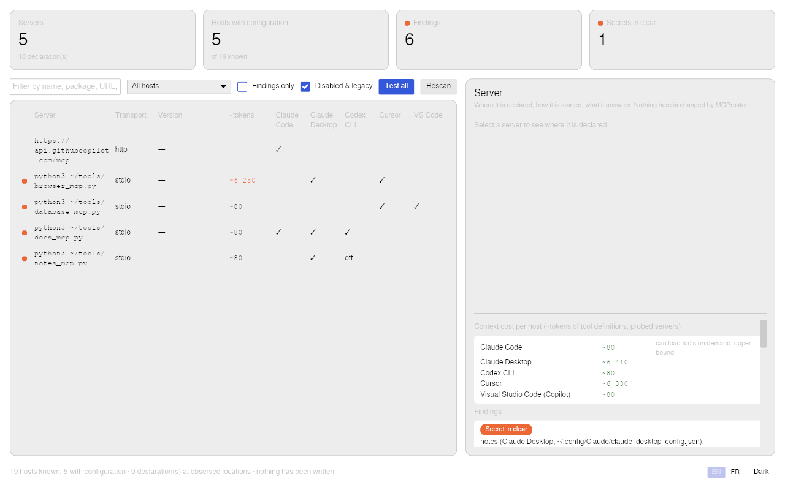
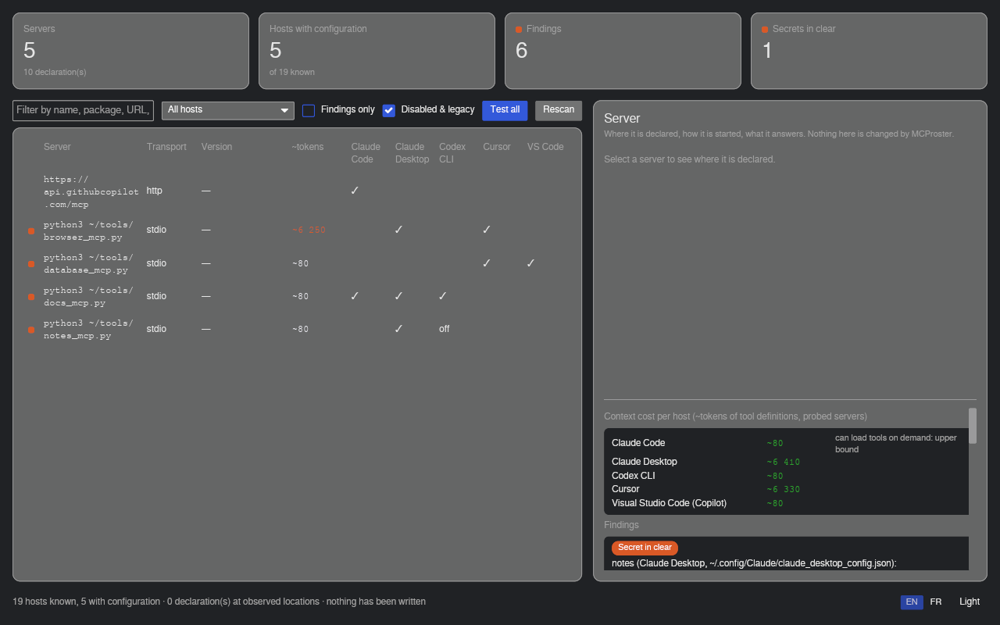

# MCProster

**Every MCP server declared on your machine, in one list — and what is wrong with it.**

Claude Desktop, Claude Code, Cursor, VS Code, Codex, Gemini CLI, OpenCode, Continue, Zed,
Goose, Kiro… each assistant keeps its own MCP configuration in its own file, in its own
format. After a few months you have the same server declared three times with three
versions, a token written in clear in one of them, a server whose command no longer exists,
and one with access to your whole home directory. MCProster reads all those files and shows
you. **It never writes to any of them.**

*The inspector, not the manager.* Tools exist to add, sync and edit MCP servers across
clients; MCProster does the opposite job: it tells you what is there, where, and what to
look at — then you act with each host's own settings.

Status: **0.2.1**. Linux. 100 % Rust. MIT.



## What it shows

- **The roster**: one row per server, one column per host that has a configuration,
  with the version each host pins. A server is the same server whether it is declared as
  `npx -y @playwright/mcp@0.0.30` or `@playwright/mcp@0.0.29`, by URL for remote servers.
- **Where each declaration lives**: host, file, line, scope (user / project), command or
  URL, environment variables with secrets masked, and buttons to open the file or copy the
  path and the command.
- **Findings**, most serious first:

  ```
  SECRET IN CLEAR   openai (Claude Desktop, ~/.config/Claude/claude_desktop_config.json): OPENAI_API_KEY written in clear
  WIDE ACCESS       filesystem (Claude Desktop, …): access to /home
  NO CONFIRMATION   playwright (Gemini CLI, ~/.gemini/settings.json): tool confirmations skipped (trust / autoApprove / alwaysAllow)
  COMMAND MISSING   ghost (Zed, ~/.config/zed/settings.json): command `ghost-mcp` not found
  VERSIONS DIFFER   `@playwright/mcp`: versions differ (0.0.29 / 0.0.30)
  DECLARED TWICE+   `@playwright/mcp` declared 3 times: Amp (0.0.29), Gemini CLI (0.0.30), Visual Studio Code (Copilot) (0.0.30)
  UNREADABLE        ~/.codeium/windsurf/mcp_config.json (Windsurf): invalid JSON: expected `,` or `}` at line 1 column 46
  ```

  Each finding comes with what *you* can do — `claude mcp remove …`, the host's settings
  page — displayed, never executed.
- **A probe, on demand**: start one server exactly as its host would — or all of them,
  after one confirmation that lists the commands — ask it `initialize` and `tools/list`,
  stop it. Ten seconds at most, no tool called, remote servers never contacted. You see
  the server's name and version and the tools it exposes.
- **What they cost in context** (0.2): every host sends the definitions of every tool to
  the model with every request; one user measured 43 000 tokens of a 99 000-token window
  gone before the first word. After a probe, MCProster shows ~tokens per tool, per server
  and per host, and raises a finding above ~5 000 tokens for one server or ~20 000 for one
  host. Estimates (characters / 4, ±20 %), method and thresholds in
  [`docs/context-cost.md`](docs/context-cost.md).

## Three promises

1. **Read-only.** No configuration file is ever written, moved or deleted. The only files
   MCProster writes are its own, under `~/.config/mcproster/`: your interface settings and
   the dated probe results (names, versions, tool names — never a value from a config file).
2. **No network.** Nothing leaves the machine. Remote (HTTP/SSE) servers are listed, never
   contacted. There is no telemetry and no update check.
3. **Secrets masked everywhere.** A credential is masked the moment it is read
   (`sk-pro…6789`), in the window, in the terminal, in `--json`, in the saved probe results.
   References the host expands itself (`${OPENAI_API_KEY}`, `${env:TOKEN}`,
   `{env:KEY}`, `${{ secrets.X }}`) are shown as written and are never flagged.

The test suite checks the first and the third on a fake home that represents every host:
every file is byte-identical after an inventory, and no clear secret appears anywhere in
the output.

## Hosts

19 hosts, 39 locations, each one established from the vendor's documentation or source
code, or marked as observed on a real machine — with the URL, the date and the words it
was read from. The full table, the rule schema and what we learnt are in
[`docs/hosts.md`](docs/hosts.md); `mcproster hosts` prints the same from the binary.

Claude Desktop (config and `.mcpb` extensions) · Claude Code (user, local, project) · Cursor ·
Windsurf · Visual Studio Code (Copilot, incl. the shared `.mcp.json`) · GitHub Copilot CLI ·
Cline · Roo Code · Codex CLI · Gemini CLI · Qwen Code · OpenCode · Continue · Zed · Goose ·
Amp · LM Studio · Kiro.

Not read yet, with the reason in `hosts/_not-read.toml`: Kilo Code, JetBrains, Warp, 5ire,
Trae, Aider. Missing yours? A host is a TOML file with sources; see
[CONTRIBUTING.md](CONTRIBUTING.md).

## Install

Packages are on the [releases page](https://github.com/blackberrylabs/mcproster/releases).

```bash
# Debian / Ubuntu
sudo apt install ./mcproster_0.2.1-1_amd64.deb

# Fedora
sudo dnf install ./mcproster-0.2.1-1.x86_64.rpm

# Any distribution
chmod +x MCProster-0.2.1-x86_64.AppImage && ./MCProster-0.2.1-x86_64.AppImage
```

Each package ships both the desktop app (`mcproster-app`) and the command line
(`mcproster`). From source: `cargo build --release` (Rust 1.80+).

## Command line

```bash
mcproster list              # every server, with the hosts and files that declare it
mcproster findings          # duplicates, secrets, missing commands, wide access, …
mcproster files             # the files that were looked at
mcproster hosts             # what MCProster knows about each host, and how
mcproster probe <server>    # start it as its host would, initialize + tools/list, stop it
mcproster probe --all       # every enabled stdio server, after one confirmation listing the commands
mcproster context           # ~tokens of tool definitions per server and per host
mcproster report            # the inventory as a bbl-report/1 document (Blackberrylabs tower)
mcproster --json list       # for scripts
mcproster --home /mnt/old   # inventory another home (a backup, a test fixture)
```

## Desktop app

Same core, one window: the servers × hosts table (with a ~tokens column once probed), a
text filter, a host picker and "findings only" / "disabled & legacy" toggles; *Test all*;
the detail of the selected server with *Open file*, *Copy path*, *Copy command* and
*Test*; the context cost per host and the findings underneath, each with the action you
could take. English by default, French on demand; light and dark.



## Reading the output

- **Declared twice or more** is a fact, not a verdict: you may want the same server in
  Claude Code and Cursor. It becomes worth a look when the versions differ, or when one of
  the declarations is dead.
- **A shared file** (`.mcp.json` at a project root, read by Claude Code *and* VS Code) is
  one declaration shown for two hosts, not a duplicate.
- **Location observed, not documented** means the path was seen on a real machine rather
  than read in the vendor's documentation (for instance Claude Desktop on Linux, which has
  no official build). The output says so; treat it with the corresponding care.
- **Disabled** servers are still declarations: they are listed, marked, and hidden with
  the "disabled & legacy" toggle.
- **Not in cache** is information, not a problem: an `npx` / `uvx` server whose package is
  not on the machine yet will work, but will download first.
- **Context cost** figures are estimates: hosts serialise tool definitions their own way,
  and Claude Code can load tools on demand, so its figure is an upper bound.

## How it is built

A Rust workspace: `crates/core` (rules, inventory, probe, cost — no UI, no network),
`crates/cli`, `crates/app` (iced). Host rules in `hosts/*.toml`, embedded in the binaries.
The rule schema, path resolution, file readers and secret masking come from
[`bbl-hostrules`](https://github.com/blackberrylabs/bbl-hostrules), the crate shared by the
Blackberrylabs tools; the interface from [`bbl-ui`](https://github.com/blackberrylabs/bbl-ui);
`mcproster report` speaks [`bbl-report`](https://github.com/blackberrylabs/bbl-report), the
contract of the Blackberrylabs control tower.
`#![forbid(unsafe_code)]` everywhere. The design brief, plan and journal are kept in French
at the root (`BRIEF.md`, `PLAN.md`, `JOURNAL.md`); code, comments and documentation are in
English.

By [Alexandre Do](https://github.com/blackberrylabs), who also made
[Cleanator](https://github.com/blackberrylabs/cleanator) — a disk cleaner for developers
who run AI on Linux, built on the same principle: show, explain, never act in your place.

## License

MIT — see [LICENSE](LICENSE).
